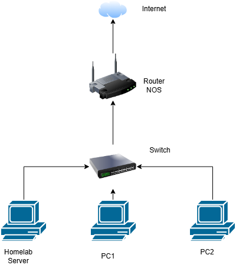

# Hardware Inventory

## Current Physical Infrastructure

---
## Homelab Server

| Component   | Details                       | Status    |
| ----------- | ----------------------------- | --------- |
| Motherboard | Z370-A PRO                    | Confirmed |
| CPU         | Intel Core i7-8700 @ 3.20 GHz | Confirmed |
| RAM         | 16 GB                         | Confirmed |
| Storage     | 320 GB Maxtor 6V320F0 HDD     | SMART passed; GPT present but not yet provisioned as backup storage |
| Storage     | 1 TB WDC WD10EZEX-0 HDD       | Configured as Proxmox Directory storage `hdd-1tb-media`; planned for media data |
| Storage     | 500 GB WD_BLACK SN710 SSD     | Proxmox system and VM storage |
| Network     | 1x Gigabit Ethernet           | Confirmed |
| Hypervisor  | Proxmox VE                    | Installed |

## Current Limitations
- Single Gigabit Ethernet interface on server
- Unmanaged switch
- ISP-provided router
- OPNsense will initially protect only the virtual lab network

## BIOS Configuration

Initial configuration for the Proxmox host:

| Setting                                | Value                                | Reason                                              |
| -------------------------------------- | ------------------------------------ | --------------------------------------------------- |
| Intel Virtualization Technology (VT-x) | Enabled                              | Required for hardware-assisted virtualization       |
| Intel VT-d                             | Enabled                              | Enables IOMMU and future PCI passthrough            |
| Boot Mode                              | UEFI                                 | Preferred boot mode for Proxmox                     |
| CSM / Legacy Boot                      | Disabled                             | Ensures the system boots exclusively in UEFI mode   |
| SATA Mode                              | AHCI                                 | Provides standard Linux storage compatibility       |
| Secure Boot                            | Disabled                             | Avoids installation and driver compatibility issues |
| Fast Boot                              | Disabled                             | Makes BIOS access and troubleshooting easier        |
| Hyper-Threading                        | Enabled                              | Makes all CPU threads available to Proxmox          |
| Intel SpeedStep / CPU C-States         | Enabled                              | Reduces power consumption while idle                |
| Above 4G Decoding                      | Enabled, if available                | Prepares the system for future PCI passthrough      |
| Resizable BAR                          | Enabled                              | Enabled in the current BIOS configuration           |
| XMP                                    | Enabled                              | Allows the RAM to run at its rated profile          |

The Proxmox installation USB should have boot priority during installation. After
installation, the 500 GB WD_BLACK SN710 SSD should be configured as the primary
boot device.

The following options will remain disabled or unchanged during the initial phase:

- **Restore after AC Power Loss:** The server is not currently intended to provide
  continuous uptime.
- **Wake-on-LAN:** Remote power-on is not required at this stage.
- **CPU overclocking:** Disabled; stock settings are preferred for stability.

## Planned Upgrades

| Upgrade | Reason | Phase | Status |
|---|---|---|---|
| Managed switch | VLAN support and segmentation | Phase 2 | Planned |
| Second Intel NIC | Better OPNsense/firewall deployment | Phase 2 | Planned |

## Related Notes
- [Network Architecture](03_Network_Architecture.md)
- [Proxmox](04_Proxmox.md)
- [OPNsense](06_OPNsense.md)
