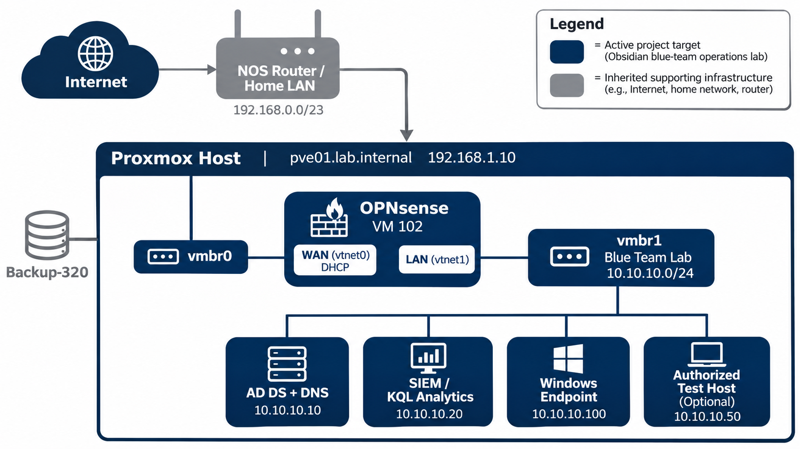

# Network Architecture

## Target Blue Team Architecture

## Scope

This note documents inherited infrastructure and the target
isolated network for the active Blue Team Operations Lab.

## Physical Network

| Device | Role | Notes |
| --- | --- | --- |
| NOS Router | ISP router/default gateway | Current edge device |
| Unmanaged Switch | LAN switching | No VLAN support |
| PC1 / PC2 | Physical clients | Home-LAN clients |
| Homelab Server | Proxmox host | Runs core services and preserved lab VMs |

## Inherited Uplink Network

### `vmbr0` — Home LAN bridge

Physical bridge for Proxmox management and the OPNsense WAN interface. It
provides the lab's upstream Internet access through the home router.

### Physical LAN — `192.168.0.0/23`

| Device / Service | Address | Assignment |
| --- | --- | --- |
| NOS Router | `192.168.1.1/23` | Existing gateway, DHCP and DNS |
| Proxmox (`pve01.lab.internal`) | `192.168.1.10/23` | Static |
| OPNsense WAN | DHCP; `192.168.1.233/23` observed | Preserved future-lab VM |

Confirm the router DHCP-pool boundaries before creating further assignments or reservations.

## Isolated Lab Network

### `vmbr1` — Reserved internal bridge

`vmbr1` has no physical ports, host IP address or gateway. It and OPNsense VM
102 form the starting point for the Blue Team Operations Lab.

### Target Blue Team Lab — `10.10.10.0/24`

| Role | Planned address | Purpose |
| --- | --- | --- |
| OPNsense LAN | `10.10.10.1` | Gateway, firewall and future log source |
| AD DS / DNS | `10.10.10.10` | Identity, DNS and directory telemetry |
| SIEM | `10.10.10.20` | Central log analysis and KQL workflow |
| Windows endpoint | DHCP or reserved address | Endpoint telemetry and controlled tests |

All target addresses require confirmation during Phase A1; this table is a
design baseline, not a record of deployed services.

## Blue Team Network Objectives

- Keep the enterprise lab isolated on `vmbr1`.
- Permit only necessary lab egress through OPNsense.
- Collect time-aligned identity, endpoint and firewall telemetry in the SIEM.
- Do not add router port forwards; administration remains on the local network.

## Project Boundary

The Blue Team Operations Lab will use the Proxmox host, `vmbr1` and OPNsense VM
102 for Active Directory, SIEM, telemetry, investigations and controlled tests.

## Related Notes

- [Proxmox](04_Proxmox.md)
- [OPNsense](05_OPNsense.md)
- [Active Directory](06_Active_Directory.md)
- [SIEM and Telemetry](07_SIEM_and_Telemetry.md)
- [Project Roadmap](08_Project_Roadmap.md)
- [TODO](../TODO.md)

