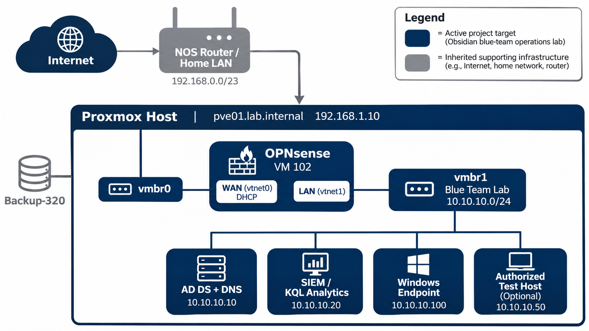

# Network Architecture

## Target Blue Team Architecture

## Scope

This note documents inherited infrastructure and the target
isolated network for the active Blue Team Operations Lab.

## Physical Network

| Device | Role | Notes |
| --- | --- | --- |
| NOS Router | ISP router/default gateway | Current edge device |
| Unmanaged Switch | LAN switching | No VLAN support |
| PC1 / PC2 | Physical clients | Home-LAN clients |
| Homelab Server | Proxmox host | Runs core services and preserved lab VMs |

## Inherited Uplink Network

### `vmbr0` — Home LAN bridge

Physical bridge for Proxmox management and the OPNsense WAN interface. It
provides the lab's upstream Internet access through the home router.

### Physical LAN — `192.168.0.0/23`

| Device / Service | Address | Assignment |
| --- | --- | --- |
| NOS Router | `192.168.1.1/23` | Existing gateway, DHCP and DNS |
| Proxmox (`pve01.lab.internal`) | `192.168.1.10/23` | Static |
| OPNsense WAN | DHCP; `192.168.1.233/23` observed | Active lab firewall; address last observed |

Confirm the router DHCP-pool boundaries before creating further assignments or reservations.

## Isolated Lab Network

### `vmbr1` - Active internal lab bridge

vmbr1 has no physical ports, host IP address or gateway. OPNsense VM 102
routes lab traffic through its WAN on vmbr0. Absence of a physical bridge port
does not itself prove lab-to-home firewall isolation; rule validation is pending.

### Lab Network - 10.10.10.0/24

| Role | Address | Deployment / purpose |
| --- | --- | --- |
| OPNsense LAN | 10.10.10.1 | Deployed gateway; future firewall-log source |
| DC01 AD DS / DNS | 10.10.10.10 | Deployed identity/DNS; local audit baseline configured |
| SIEM01 | 10.10.10.20 | Deployed Elastic Stack/Fleet; controlled DC01 ingestion pending |
| Windows endpoint | DHCP or reserved address, not assigned here | Planned; not deployed |

SIEM01 DNS uses OPNsense Unbound, forwarding lab.internal to DC01 and resolving
external names independently. Domain clients/DC01 use AD DNS. Service/policy
details and validation boundaries: [Current Lab State](12_Current_Lab_State.md).

Kibana administration uses source-restricted OPNsense WAN TCP 5601 DNAT to SIEM01,
from the trusted home-LAN workstation only. This is distinct from a port-forward
on the home router: no Internet-facing router forward is part of the design.
No OPNsense WAN NAT is configured for Elasticsearch 9200/9300 or Fleet 8220/8221.
TCP 8221 is local communication on SIEM01, not an agent-facing service.

## Blue Team Network Objectives

- Keep the enterprise lab isolated on `vmbr1`.
- Permit only necessary lab egress through OPNsense.
- Collect time-aligned identity, endpoint and firewall telemetry in the SIEM.
- Do not add router port forwards; administration remains on the local network.

## Project Boundary

The Blue Team Operations Lab uses the Proxmox host, `vmbr1` and OPNsense VM
102 for Active Directory, SIEM, telemetry, investigations and controlled tests.

## Related Notes

- [Proxmox](04_Proxmox.md)
- [OPNsense](05_OPNsense.md)
- [Active Directory](06_Active_Directory.md)
- [SIEM and Telemetry](07_SIEM_and_Telemetry.md)
- [Project Roadmap](08_Project_Roadmap.md)
- [TODO](../TODO.md)
