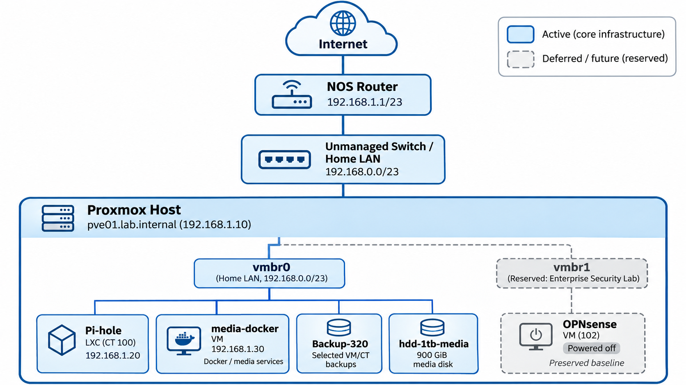

# Network Architecture

## Current Architecture Diagram

## Scope

This note documents the active **HomeLab Core** network: the home LAN, Proxmox management and services connected through `vmbr0`. The separate private enterprise network is preserved for the future **Enterprise Security Lab** and is not an active part of this project.

## Physical Network

| Device | Role | Notes |
| --- | --- | --- |
| NOS Router | ISP router/default gateway | Current edge device |
| Unmanaged Switch | LAN switching | No VLAN support |
| PC1 / PC2 | Physical clients | Home-LAN clients |
| Homelab Server | Proxmox host | Runs core services and preserved lab VMs |

## Active Virtual Network

### `vmbr0` — Home LAN bridge

Physical bridge for Proxmox management, Pi-hole and `media-docker`. The OPNsense WAN is also connected here while VM 102 is retained for later reuse.

### Physical LAN — `192.168.0.0/23`

| Device / Service | Address | Assignment |
| --- | --- | --- |
| NOS Router | `192.168.1.1/23` | Existing gateway, DHCP and DNS |
| Proxmox (`pve01.lab.internal`) | `192.168.1.10/23` | Static |
| Pi-hole | `192.168.1.20/23` | Static |
| Media Docker VM | `192.168.1.30/23` | Planned reservation |
| OPNsense WAN | DHCP; `192.168.1.233/23` observed | Preserved future-lab VM |

Confirm the router DHCP-pool boundaries before creating further assignments or reservations.

## Preserved Future-Lab Network

### `vmbr1` — Reserved internal bridge

`vmbr1` has no physical ports, host IP address or gateway. It and OPNsense VM 102 are retained as a handoff baseline and may remain powered down until the Enterprise Security Lab begins. Previous `10.10.10.0/24` configuration details remain in [OPNsense](06_OPNsense.md) as historical reference only.

## Core Network Objectives

- Keep Proxmox, Pi-hole and media services stable and private on the home LAN.
- Confirm stable addressing for `media-docker`.
- Improve backup and recovery before exposing services remotely.

## Future Project Boundary

**Enterprise Security Lab** will separately document its own Active Directory, SIEM, segmentation, VPN and security-testing architecture. It may reuse the Proxmox host, `vmbr1` and OPNsense VM 102.

## Related Notes

- [Proxmox](04_Proxmox.md)
- [Pi-hole](05_Pi-hole.md)
- [OPNsense](06_OPNsense.md)
- [Docker](08_Docker.md)
- [Project Roadmap](12_Project_Roadmap.md)
- [TODO](../TODO.md)
